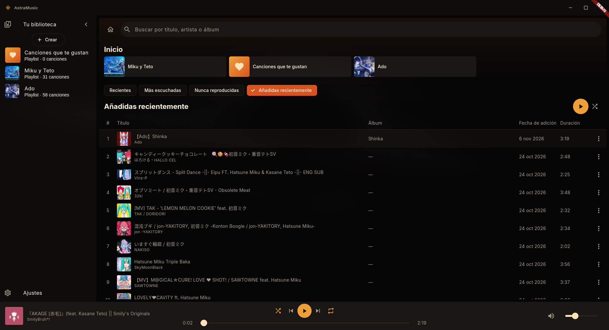
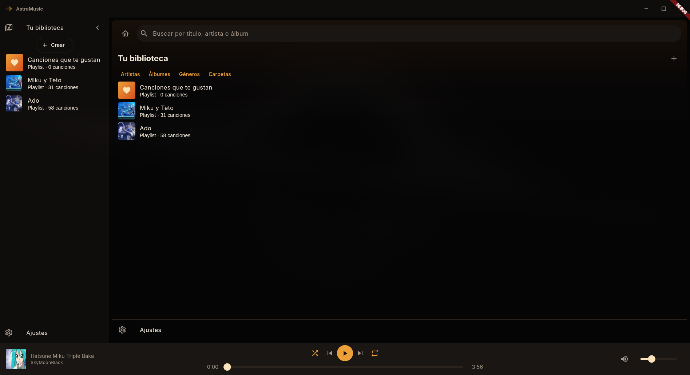
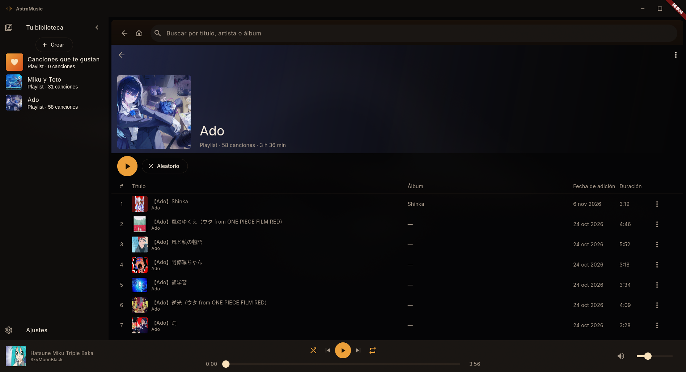

# AstraMusic v1.2.0


AstraMusic es un reproductor de música local, gratuito, 100 % open source y
sin ánimo de lucro. El proyecto nace para que cualquier persona pueda disfrutar
su propia biblioteca musical sin suscripciones, anuncios ni pagos para acceder
a las funciones del reproductor.

La aplicación reproduce archivos locales y permite importar audio desde una URL
de YouTube, incluida una playlist. No ofrece un catálogo de streaming ni incluye
contenido protegido. La persona usuaria conserva el control de sus archivos y
es responsable de contar con los permisos necesarios sobre ellos.

## Vista previa de la aplicación

Capturas de la interfaz de escritorio de AstraMusic.



| Biblioteca | Playlist |
| --- | --- |
|  |  |
| **Reproductor y cola** | **Configuración** |
|  |  |

## Plataformas compatibles

- Android.
- Linux.
- Windows.

AstraMusic está construido con Flutter 3.47.x y Dart 3.13.x.

## Descargas directas

| Plataforma | Versión | Descarga |
| --- | --- | --- |
| Android | v1.2.0 | [Descargar APK](https://github.com/nicorioso/AstraMusic/releases/download/v1.2.0/AstraMusic-v1.2.0.apk) |
| Windows | v1.2.0 | Próximamente (en actualización para v1.2.0) |

Linux se puede ejecutar desde el código fuente; las instrucciones de compilación
están en [la guía de publicación](docs/release.md). Los binarios oficiales también
se anuncian en **[AstraMusic Discord](https://discord.gg/pRpghjs34)**.

## Funciones principales

- Biblioteca local de canciones.
- Reproducción en segundo plano y controles multimedia del sistema.
- Cola de reproducción, modo aleatorio y repetición.
- Búsqueda, favoritos y playlists.
- Selección múltiple de canciones: pulsación prolongada y toques en Android;
  Ctrl/Cmd y Shift en escritorio para seleccionar y aplicar acciones en lote.
- Importación y exportación de playlists autónomas `.amplaylist`, con audios y
  carátulas opcionales; listas inteligentes basadas en historial y biblioteca.
- Descargas de YouTube: importa pistas individuales o playlists completas a la
  biblioteca local y crea automáticamente una playlist en Drift con las pistas
  obtenidas. Muestra antes los metadatos y carátulas, informa el progreso y los
  errores por pista, y permite cancelar. Conserva las pistas logradas si alguna
  falla, evita duplicados sin sobrescribir cambios del usuario y guarda carátulas
  persistentes. En Android, **Actualizar motor** renueva el extractor a petición
  del usuario.
- Lectura de metadatos y carátulas incrustadas.
- Interfaz adaptable para dispositivos móviles y computadores, con atajos de
  teclado y barra de título propia en escritorio.

Las descargas son opcionales para usar el reproductor. En Linux y Windows
requieren `yt-dlp` y `ffmpeg` en el `PATH`; las playlists usan hasta dos descargas
simultáneas. Android incluye el motor y FFmpeg en la aplicación y procesa una
pista por vez. El audio se guarda en el almacenamiento privado de AstraMusic;
se priorizan formatos de audio nativos para evitar conversiones innecesarias.
Consulta la [guía de descargas](docs/guia-descargas-youtube.md).

## Estado del proyecto

**v1.2.0. Fase 15 (Descargas de YouTube): completada.** Incluye
importación en Android y escritorio, playlists, mejoras de latencia y soporte
nativo para paquetes Android `release`.

## Requisitos generales

1. Instalar [Flutter](https://docs.flutter.dev/get-started/install) 3.47.x, que
   incluye Dart 3.13.x.
2. Agregar el directorio `bin` de Flutter al `PATH`.
3. Instalar Git y las herramientas correspondientes a la plataforma de destino.
4. Comprobar el entorno:

```bash
flutter --version
flutter doctor -v
```

No se deben actualizar Flutter, Dart ni las dependencias del proyecto sin
verificar antes su compatibilidad. Para compilar un APK release firmado, consulta
[la guía de publicación](docs/release.md).

## Obtener el proyecto

```bash
git clone https://github.com/nicorioso/AstraMusic.git
cd AstraMusic
flutter pub get
```

## Ejecutar en Linux

Se necesita un entorno Linux con soporte de escritorio de Flutter y las
herramientas nativas de compilación, entre ellas Clang, CMake, Ninja, pkg-config
y las cabeceras de GTK 3. Los nombres de los paquetes cambian según la
distribución.

Para usar descargas, instala por separado `yt-dlp` y `ffmpeg` y verifica que
ambos comandos estén disponibles en el `PATH`. No se necesitan para reproducir
archivos locales. Las playlists usan hasta dos descargas simultáneas.

```bash
flutter config --enable-linux-desktop
flutter doctor -v
flutter devices
flutter run -d linux
```

El último comando compila una versión de desarrollo y abre AstraMusic. Para
usar una carpeta musical, selecciónala desde la aplicación.

## Ejecutar en Windows

Se requiere Windows 10 u 11, Git, Flutter 3.47.x y Visual Studio 2022 con la
carga de trabajo **Desarrollo para el escritorio con C++**. Visual Studio Code
por sí solo no reemplaza las herramientas de compilación de Visual Studio.
Para usar descargas, instala por separado `yt-dlp` y FFmpeg, agrega ambos al
`PATH` y reinicia la terminal; las playlists usan hasta dos descargas simultáneas.

En PowerShell, desde la raíz del proyecto:

```powershell
flutter config --enable-windows-desktop
flutter doctor -v
flutter devices
flutter run -d windows
```

El último comando compila y ejecuta la versión de desarrollo para Windows.

### Crear el instalador de Windows

En Windows, instala Inno Setup 6.3 o posterior y usa PowerShell desde la raíz del proyecto.
El script detiene el empaquetado si falla alguna verificación o faltan archivos
de la compilación. El instalador incluye toda la distribución de Flutter,
crea un acceso directo en el Menú Inicio y permite elegir uno en el Escritorio.
Inno Setup registra el desinstalador automáticamente.

```powershell
.\windows\build-installer.ps1
```

El instalador queda en `build/windows/installer/AstraMusic-Setup-1.2.0.exe`.
Si `ISCC.exe` no está en el `PATH`, pasa su ruta con `-Iscc`. Para compilar
solo el instalador después de construir Windows, usa
`ISCC.exe windows/installer.iss`.

## Ejecutar en Android

Se necesita Android Studio o el Android SDK configurado, además de un emulador
o dispositivo físico. En un teléfono real, activa las opciones de desarrollador
y la depuración USB, conecta el dispositivo y acepta la autorización mostrada
en su pantalla.

```bash
flutter doctor -v
flutter devices
flutter run -d <id-del-dispositivo>
```

Reemplaza `<id-del-dispositivo>` por el identificador que muestra
`flutter devices`. Al usar AstraMusic, concede los permisos de audio y
notificaciones que Android solicite. Las canciones se agregan mediante
**Añadir archivos** o desde **Descargas de YouTube**. El manifiesto incluye
`INTERNET` para esta función; no hace falta instalar `yt-dlp` o FFmpeg por
separado: `youtubedl-android` y FFmpeg vienen integrados. Si el extractor deja
de funcionar, usa **Actualizar motor** en la pantalla de descargas; intenta la
versión nightly y después la estable. La actualización requiere red y se inicia
solo al pulsar el botón.

Para compilar un APK `release` firmado, configura `android/key.properties` como
indica la [guía de publicación](docs/release.md). El proyecto referencia reglas
R8/ProGuard para el motor y usa `jniLibs.useLegacyPackaging` para sus bibliotecas
nativas; la configuración actual no activa explícitamente la minificación.

## Calidad del código

Antes de enviar cambios, ejecuta:

```bash
flutter analyze --no-pub
flutter test --reporter failures-only
```

## Código abierto y contribuciones

AstraMusic se desarrolla de forma abierta para que la comunidad pueda estudiar,
mejorar y adaptar el reproductor. Las contribuciones que mantengan su propósito
gratuito y sin ánimo de lucro son bienvenidas.

AstraMusic se distribuye bajo la [licencia MIT](LICENSE). La fuente Inter
conserva su [licencia SIL OFL 1.1](assets/fonts/OFL.txt). Al distribuir los
binarios, incluye ambos avisos de licencia.
